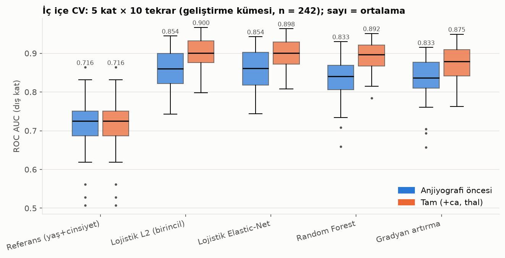
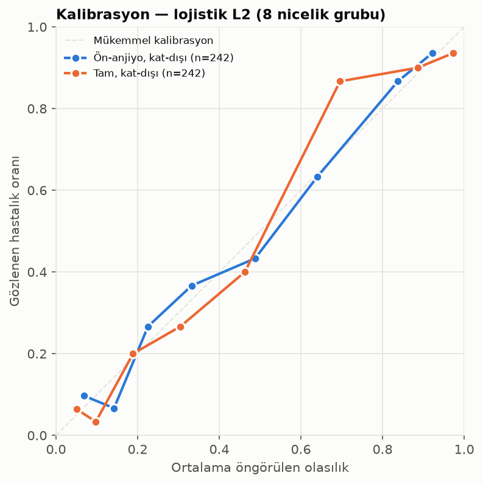
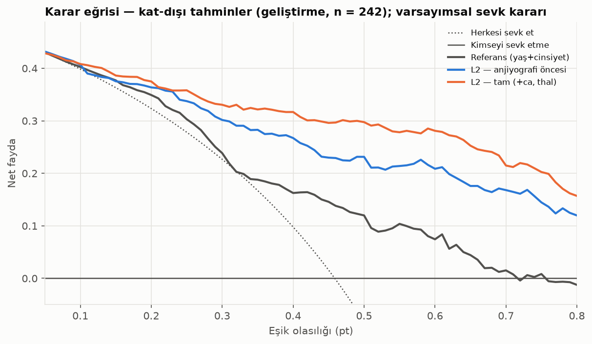
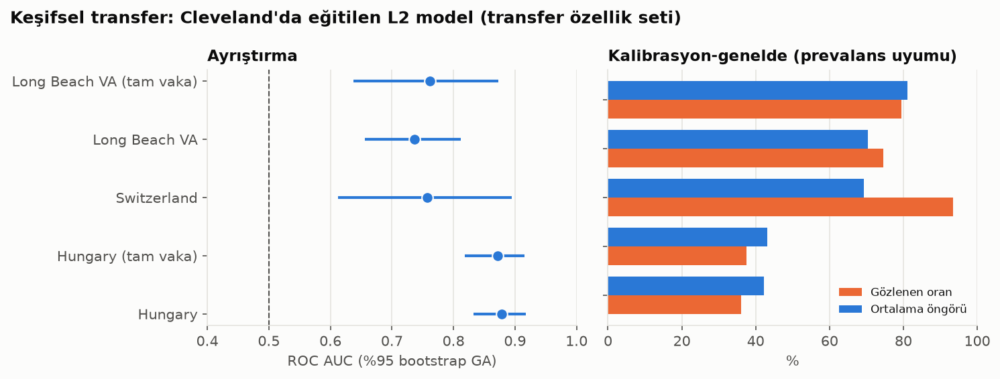
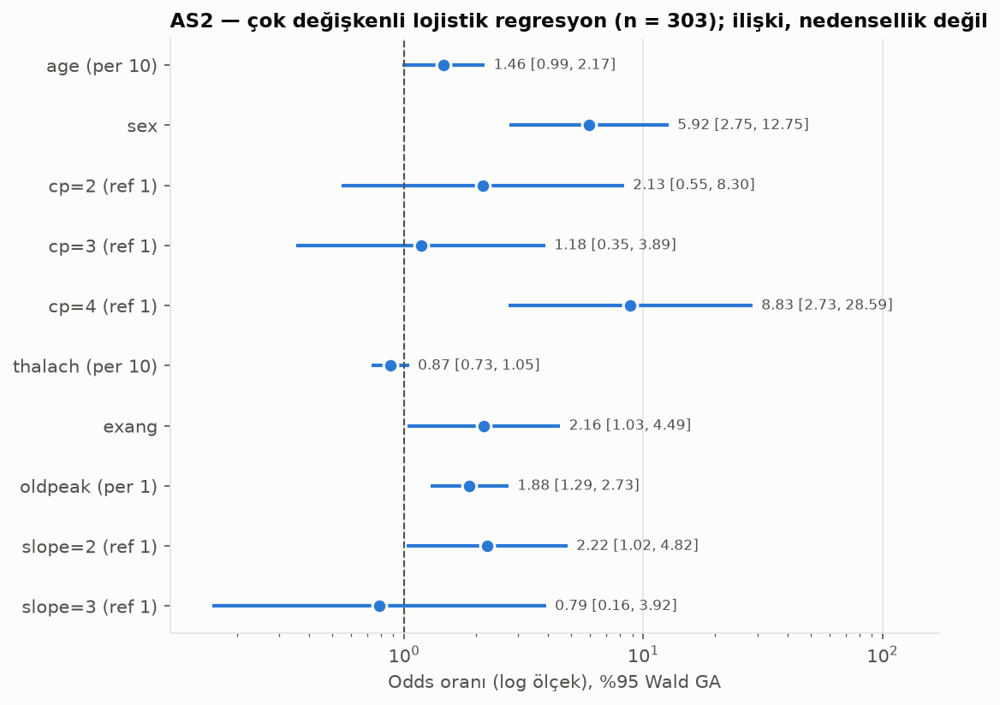
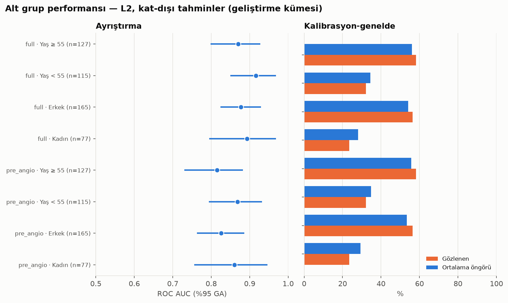

# Medical Risk Modeling Lab

**Development and internal–external evaluation of a clinical prediction model for angiographic
coronary artery disease, using the UCI Heart Disease (Cleveland) data.**

Author: Seyhan Anıl Kaya · Version 1.0.0 · Code: MIT · Reports and figures: CC BY 4.0 · Data: CC BY 4.0
(UCI, not redistributed; see [Licence](#licence))

> [!WARNING]
> **Research and education only. Not a medical device, not a diagnostic tool, not clinical decision
> support.** The data are from the 1980s, small (n = 303), drawn from patients already referred for
> coronary angiography, and have no contemporary external validation. The outcome is the
> *recorded angiographic diagnosis* (> 50 % diameter narrowing in any major vessel). It is **not**
> a future risk of disease, events or death. No individual risk calculator is provided.

The analysis is reported following the TRIPOD+AI statement (Collins et al., *BMJ* 2024). The
detailed reports are written in Turkish; this README summarises them in English.

## Research questions

| | Question | Where answered |
|---|---|---|
| RQ1 | Which clinical and exercise-test variables are associated with angiographic disease (univariable)? | Phase 1 |
| RQ2 | Do those associations persist after adjustment for age and sex? (odds ratios, not causal effects) | Phase 2 |
| RQ3 | How well do **pre-angiography** variables discriminate and calibrate in internal validation? | Phase 2 |
| RQ4 | What is the incremental value of fluoroscopy (`ca`) and thallium scintigraphy (`thal`)? | Phase 2 |
| RQ5 | Does a Cleveland model transfer to Hungary, Switzerland and Long Beach VA, and can it be updated? | Phases 2–3 |

## Data

- **Source:** UCI Machine Learning Repository, *Heart Disease* (id 45),
  DOI [10.24432/C52P4X](https://doi.org/10.24432/C52P4X), licence **CC BY 4.0**.
  Files used: `processed.cleveland.data` (development) and the processed Hungarian, Swiss and
  Long Beach VA files (external evaluation).
- **The raw data are not included in this repository.** `scripts/run_phase1.py` downloads the
  official archive from https://archive.ics.uci.edu/static/public/45/heart+disease.zip and verifies
  the SHA-256 checksums of the archive and of every file used. The checksums are pinned in
  `src/mrml/config.py` and recorded in `data/metadata/provenance.json`. If UCI ever changes the
  files, the pipeline stops instead of silently analysing different data.
- **Development cohort:** Cleveland Clinic, n = 303, 139 with disease (45.9 %). There are 6
  missing cells (`ca` 4, `thal` 2), no duplicates and no out-of-domain codes.
- **Outcome:** `num` 1–4 → disease (1); `num` 0 → no disease (0). The source documents only 0 vs 1,
  and the meaning of codes 2–4 is undocumented, so they are not interpreted as severity.
- **External cohorts:** Hungary 294 (36.1 % disease), Switzerland 123 (93.5 %), Long Beach VA 200 (74.5 %).
  These cohorts have heavy missingness (for example, `chol` is 100 % missing in Switzerland).

### Data deliberately not published

This repository contains **no patient-level data**. The following are excluded via `.gitignore`
and are recreated locally when you run the scripts:

| Not published | Why | Recreated by |
|---|---|---|
| `data/raw/`: the UCI archive and extracted files | Redistribution is not needed; the official source is downloaded and checksum-verified | `run_phase1.py` |
| `data/private/cleveland_typed.csv`: typed copy of all 303 records | Row-level patient data | `run_phase1.py` |
| `data/private/phase1/`: records with missing values, row-level consistency flags | Row-level patient values | `run_phase1.py` |
| `data/private/split_phase2.csv`: locked-test split by row | Row-keyed | `run_phase2.py` |
| `data/private/phase2/`, `data/private/phase3/`: per-person predictions paired with observed outcomes | Person-level predictions and outcomes | `run_phase2.py`, `run_phase3.py` |

Only aggregate statistics, model-performance tables, figures, reports and code are published.
[`RELEASE_MANIFEST.csv`](RELEASE_MANIFEST.csv) lists every published file with its size,
SHA-256, category and licence. `python scripts/release_manifest.py --check` verifies that list and
fails if a person-level file would enter the release.

## Methods

- **Split:** stratified 20 % locked test set (n = 61, 28 events), and a development set
  (n = 242, 111 events). The locked test set was never used for model, feature or threshold selection.
- **Internal validation:** nested cross-validation with an outer 5-fold × 10 repeats and an inner
  5-fold grid search on log-loss. All preprocessing (median/mode imputation, missingness indicator,
  scaling, one-hot encoding) sits inside a scikit-learn `Pipeline` and is refit in every
  training fold.
- **Feature sets (pre-specified):** *pre-angiography* (11 variables: demographics, symptoms,
  resting measurements, exercise ECG) and *full* (adds `ca` and `thal`).
- **Models:**
  - age + sex reference
  - **L2 logistic regression (pre-specified primary model)**
  - elastic-net logistic regression
  - random forest
  - histogram gradient boosting
  - cubic B-spline + L2 logistic regression
- **Performance measures:** ROC AUC, Brier score, calibration slope and calibration-in-the-large.
  Models are compared on the same outer folds using the Nadeau–Bengio corrected resampled t-test,
  with Holm adjustment within each family of comparisons.
- **Clinical-utility exploration:** decision-curve analysis for a *hypothetical* "refer to
  angiography or not" decision. Classification thresholds are chosen inside training folds only.
- **External evaluation:**
  - direct transport of the Cleveland model
  - within-site cross-validated intercept and logistic recalibration
  - leave-one-site-out validation

## Key results

| | Pre-angiography | Full (+ `ca`, `thal`) |
|---|---|---|
| Nested-CV AUC, L2 logistic (mean ± SD over 50 folds) | **0.854 ± 0.056** | **0.900 ± 0.039** |
| Nested-CV AUC, age + sex reference | 0.716 | 0.716 |
| Out-of-fold calibration slope (L2) | 1.04 | 1.08 |
| Locked test AUC, L2 (n = 61) [95 % CI] | 0.950 [0.887, 0.994] | 0.948 [0.881, 0.992] |

- **Simple beats complex here.** The data give no evidence that the tree ensembles or the spline
  model beat L2 logistic regression. The spline model had a lower AUC (pre-angiography
  difference −0.027; nominal p = 0.011, Holm-adjusted p = 0.043 within the spline family).
- **Incremental value of `ca`/`thal` (RQ4):** AUC +0.045 [0.012, 0.079]. This was the
  pre-specified primary comparison (nominal p = 0.009), but it is **not significant after Holm
  adjustment** across the 18 Phase 2 comparisons (p = 0.080). The direction is consistent across
  all four model types. These tests occur late in the diagnostic pathway, so
  the "full" model does not represent a screening setting.
- **Locked test vs CV:** the locked-test AUC (≈ 0.95) is higher than the CV estimate. This fits a
  small, by-chance "easy" test set; the CV estimate is the primary performance estimate.
- **Adjusted associations (RQ2, all 303 patients):**
  - male sex: OR 5.92
  - asymptomatic chest pain vs typical angina: OR 8.83
  - ST depression: OR 1.88 per mm
  - exercise angina: OR 2.16

  These are associations in a referred population, not causal effects.
- **Hypothetical decision curve:** at threshold probabilities of about 0.2–0.5, the model's net
  benefit exceeds both "refer all" and "refer none". At 0.10 it does no better than "refer all".
  This is a methodological illustration, not a recommended clinical threshold.
- **Subgroups:** predicted risk in women was higher than observed (calibration-in-the-large
  −0.43). Only 18 events were available in women, so this estimate is very uncertain. The AUC
  confidence intervals for women and men overlap, but overlap does **not** show equal
  performance.
- **Transportability:**

  | External site | AUC of the Cleveland model |
  |---|---|
  | Hungary | 0.878 |
  | Switzerland | 0.758 |
  | Long Beach VA | 0.737 |

  Calibration-in-the-large differed between sites. Recalibration fixed calibration but not
  discrimination. Pooling sites did not improve leave-one-site-out discrimination.

### Figures

| | |
|---|---|
|  |  |
| Nested-CV AUC by model and feature set | Out-of-fold calibration (L2) |
|  |  |
| Decision curve (hypothetical referral decision) | External transfer: discrimination and calibration-in-the-large |
|  |  |
| Adjusted odds ratios (RQ2) | Subgroup performance |

All 18 figures are in [`reports/figures/`](reports/figures/).

## Limitations

- **Spectrum and selection bias:** all patients were referred for angiography, and the 46 %
  prevalence is far from any screening population.
- **Small sample:** about 6 events per candidate parameter. The locked test set (61 patients) and
  the subgroup analyses have little statistical power.
- **Dated, single-centre development data** with no medication, smoking, diabetes or ethnicity
  variables. Outcome-assessor blinding and measurement protocols are undocumented.
- **External analyses are exploratory:** missingness at the external sites is heavy and probably
  not at random, and case-mix differs substantially between sites.
- **Multiplicity:** many comparisons were run. P-values are reported nominally and Holm-adjusted
  within families; decision-curve confidence intervals ignore model-refitting uncertainty.
- **Protocol deviations:** Phase 3 analyses (decision curve, thresholds, recalibration,
  leave-one-site-out, splines) were added after the Phase 2 results. They were not part of the
  original analysis plan.

## Reproducing the analysis

Requires Python ≥ 3.11 and internet access for the one-time data download. It was tested on
Python 3.14.4 with the exact versions in `requirements-lock.txt`, on Windows 11.

```bash
git clone <repository-url> medical-risk-modeling-lab
cd medical-risk-modeling-lab
python -m venv .venv
# Windows: .venv\Scripts\activate    macOS/Linux: source .venv/bin/activate
pip install -r requirements-lock.txt   # exact tested versions (or: requirements.txt)
python scripts/run_phase1.py     # download + SHA-256 check, data audit, EDA        (~1 min)
python scripts/run_phase2.py     # nested CV, locked test, odds ratios, transfer     (~5-10 min)
python scripts/run_phase3.py     # decision curve, thresholds, recalibration, LOSO   (~5-10 min)
python -m pytest -q              # 58 tests
python scripts/audit_release.py  # consistency / leakage-structure / privacy / inventory audit
python scripts/release_manifest.py --check   # published-file inventory
```

Run the steps in this order: `run_phase1.py` downloads the data, and `run_phase2.py` creates
the locked-test split that `run_phase3.py` reuses. The data-dependent tests are skipped until
`run_phase1.py` has been run. All paths are relative to the project root, and random seeds are
fixed (`RANDOM_SEED = 42`). In the release check, a clean environment re-downloaded the data and
reran all phases. The regenerated published outputs (tables, all 18 figures, data
dictionary) and the regenerated unpublished files (downloaded data, person-level outputs) were
byte-for-byte identical to the originals; see `reports/release_readiness.md`.

## Repository layout

```
src/mrml/            config, data_io, dictionary, audit, stats, plots,
                     modeling, plots_phase2, phase3, plots_phase3
scripts/             run_phase1.py, run_phase2.py, run_phase3.py, audit_release.py,
                     release_manifest.py
tests/               pytest suite (data integrity, leakage, metrics, reproducibility)
data/raw/            UCI archive, created by run_phase1.py (git-ignored, not redistributed)
data/private/        all person-level outputs, created by run_phase1-3.py (git-ignored)
data/metadata/       provenance.json (source, DOI, licence, checksums)
docs/                data dictionary (TR/EN), decisions, analysis plan, TRIPOD+AI checklist
reports/             phase reports, final report, release audit, figures/, tables/
```

| Document | Content |
|---|---|
| [`reports/final_report.md`](reports/final_report.md) | Consolidated report, TRIPOD+AI structure (Turkish) |
| [`docs/tripod_ai_checklist.md`](docs/tripod_ai_checklist.md) | All 52 TRIPOD+AI sub-items mapped to report sections |
| [`reports/phase1_report.md`](reports/phase1_report.md) … [`phase3_report.md`](reports/phase3_report.md) | Detailed phase reports |
| [`reports/release_readiness.md`](reports/release_readiness.md) | Final scientific audit and release checklist |

## Citation and acknowledgements

**This project:** see [`CITATION.cff`](CITATION.cff) (GitHub shows a "Cite this repository"
button). No DOI has been assigned to this project.

> Kaya, S. A. (2026). *Medical Risk Modeling Lab* (Version 1.0.0) [Computer software].

**Please also cite the data set and the original study:**

- Janosi, A., Steinbrunn, W., Pfisterer, M., & Detrano, R. (1989). *Heart Disease* [Dataset].
  UCI Machine Learning Repository. https://doi.org/10.24432/C52P4X
- Detrano, R., Janosi, A., Steinbrunn, W., Pfisterer, M., Schmid, J., Sandhu, S., Guppy, K.,
  Lee, S., & Froelicher, V. (1989). International application of a new probability algorithm for
  the diagnosis of coronary artery disease. *American Journal of Cardiology*, 64(5), 304–310.
  https://doi.org/10.1016/0002-9149(89)90524-9

The data donors asked that publications name the principal investigators:

- Andras Janosi, M.D. — Hungarian Institute of Cardiology, Budapest
- William Steinbrunn, M.D. — University Hospital, Zurich
- Matthias Pfisterer, M.D. — University Hospital, Basel
- Robert Detrano, M.D., Ph.D. — V.A. Medical Center, Long Beach and Cleveland Clinic Foundation

Reporting guideline: Collins, G. S., Moons, K. G. M., Dhiman, P., et al. (2024). TRIPOD+AI
statement. *BMJ*, 385, e078378. https://doi.org/10.1136/bmj-2023-078378

## Licence

| What | Licence |
|---|---|
| Source code (`src/`, `scripts/`, `tests/`, configuration) | [MIT](LICENSE) © 2026 Seyhan Anıl Kaya |
| Original reports, documentation and figures (`reports/`, `docs/`, this README) | [CC BY 4.0](LICENSES/CC-BY-4.0.txt) © 2026 Seyhan Anıl Kaya |
| UCI Heart Disease data (downloaded, **not** in this repository) | [CC BY 4.0](https://creativecommons.org/licenses/by/4.0/); creators Janosi, Steinbrunn, Pfisterer & Detrano; https://doi.org/10.24432/C52P4X |
| Adapted third-party content (TRIPOD+AI checklist summaries, UCI variable descriptions) | CC BY 4.0, with attribution to the original authors |

The file-by-file scope is in [`LICENSING.md`](LICENSING.md), and third-party attributions and
dependency licences are in [`THIRD_PARTY_NOTICES.md`](THIRD_PARTY_NOTICES.md). Neither licence
implies fitness for clinical use.
